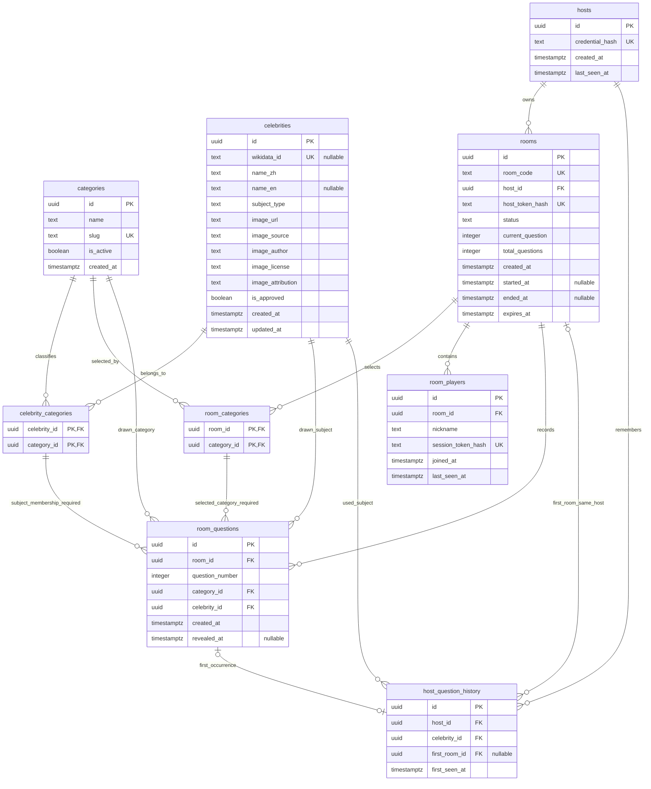

# Guess Who — Database Schema

依據 Phase 4 Database Design Specification **v1.2**。第 1–8 節保留 Phase 4 baseline／當時的後續設計；第 9 節為已部署 Phase 5，第 10 節為 Phase 6 增量。房間及引擎均已部署，完整遊戲仍等待正式題庫；Realtime 尚未實作。

## 1. 架構與範圍

- Supabase PostgreSQL，九張 `public` 應用資料表；保留 `celebrities` 表名，統一容納真人與虛構角色。
- Migration：`supabase/migrations/20261023060000_create_guess_who_schema.sql`。
- Seed：`supabase/seed.sql`，只有七個分類，不含正式人物、圖片、房間或憑證。
- 所有主鍵 UUID 預設 `gen_random_uuid()`；所有時間為 `timestamptz`。除下文標示可空外均 `NOT NULL`。
- 雲端部署須使用者另行確認；本次已於 2026-10-23 取得確認、部署至既有 Free Project，並完成 PG17 雲端結構／權限驗證。本機 SQL 測試成功本身不等於已部署。

## 2. ERD



複合 FK 另確保首次房間屬於該 Host、該房間確實出過該人物；ERD 的單欄關係不足以表達這些限制，以下 SQL 規則為準。

## 3. 欄位與限制

### categories

`id uuid PK`、`name text`、`slug text UNIQUE`、`is_active boolean DEFAULT true`、`created_at timestamptz DEFAULT now()`。

名稱不可空白；slug 限小寫英數與單一連字號分段。可新增分類或停用，不需要改 Schema。Seed 以 slug upsert，只更新名稱，不把已停用分類自動啟用。

| 序號 | name | slug | 固定 UUID 尾碼 |
| --- | --- | --- | --- |
| 1 | 演員 | actors | 000000000001 |
| 2 | 歌手 | singers | 000000000002 |
| 3 | 運動員 | athletes | 000000000003 |
| 4 | 政治人物 | politicians | 000000000004 |
| 5 | 科學家 | scientists | 000000000005 |
| 6 | 歷史人物 | historical-figures | 000000000006 |
| 7 | 動畫人物 | animated-characters | 000000000007 |

UUID 共用前綴 `10000000-0000-4000-8000-`。規格分類表的 1–7 作為展示序號，資料庫主鍵依規格採 UUID。歷史人物需有明確歷史影響力收錄標準，不等同所有已故人物；動畫人物包含日本動漫、歐美卡通與動畫電影角色，收錄與授權標準留待 Phase 8。

### celebrities

`id uuid PK`；`wikidata_id text UNIQUE NULL`（`Q` 加正整數，可多筆 NULL）；`name_zh text`；`name_en text NULL`；`subject_type text` 限 `real_person` / `fictional_character`。

`image_url text`、`image_source text` 必須為無空白的 HTTPS 字串；`image_author text`、`image_license text`、`image_attribution text` 及名稱必須非空白。HTTPS 格式檢查不代表來源合法、圖片可用或授權已驗證。

`is_approved boolean DEFAULT false`；`created_at`、`updated_at timestamptz DEFAULT now()`，限制更新時間不早於建立。唯一 trigger 使用 SECURITY INVOKER、自訂空 `search_path`，更新時維護 `updated_at`；非公開 RPC。

### celebrity_categories

`celebrity_id uuid FK`、`category_id uuid FK`，複合 PK，支援同人物多分類。刪除未被引用人物時 CASCADE 刪除關聯；分類 RESTRICT，應優先停用而非刪除。

### hosts

`id uuid PK`、`credential_hash text UNIQUE`、`created_at`、`last_seen_at timestamptz DEFAULT now()`，最後活動不得早於建立。

Hash 限 64 位小寫十六進位 SHA-256 表示。這是格式限制，不能證明原始憑證隨機性；真實憑證產生與驗證留待 Phase 5。Host ID 不能授權。

### rooms

`id uuid PK`、`room_code text UNIQUE`（六位大寫英數）、`host_id uuid FK NOT NULL`（RESTRICT）、`host_token_hash text UNIQUE`（64 位 hex）。另有 `UNIQUE(id, host_id)` 供歷史複合 FK 使用。

`status text DEFAULT 'waiting'` 限 waiting / playing / finished；`current_question integer DEFAULT 0` 限 0–15；`total_questions integer DEFAULT 15 CHECK (=15)`。

`created_at timestamptz DEFAULT now()`、`started_at timestamptz NULL`、`ended_at timestamptz NULL`、`expires_at timestamptz DEFAULT now()+24 hours`。過期時間晚於建立，開始／結束不得倒序；24 小時是目前可調整的預設保存期限，不是已完成的自動清理服務。

| 儲存狀態 | 題號 | started_at | ended_at |
| --- | --- | --- | --- |
| waiting | 0 | NULL | NULL |
| playing | 1–15 | 必填 | NULL |
| finished（未開場關房） | 0 | NULL | 必填 |
| finished（遊戲結束） | 1–15 | 必填 | 必填 |

CHECK 保證單筆狀態一致，不是完整狀態機：不會自動禁止可信後端把 finished 改回 playing，也不會自動處理過期。Phase 6 須以授權交易驗證合法轉移、題目筆數、當前題號及過期時間。刷新不會改變已儲存狀態，但恢復 UI 需 Phase 5 API。

### room_categories / room_players

- `room_categories(room_id uuid FK, category_id uuid FK)` 複合 PK；房間 CASCADE、分類 RESTRICT。Schema 允許空大廳，開始前至少一個有效分類由 Phase 6 檢查。
- `room_players`：`id uuid PK`、`room_id uuid FK CASCADE`、`nickname text`（trim 後 1–20 PostgreSQL 字元）、`session_token_hash text UNIQUE`（64 位 hex）、`joined_at` / `last_seen_at timestamptz DEFAULT now()`；活動時間不得早於加入。不建立會員表或要求暱稱唯一。

### room_questions

`id uuid PK`、`room_id uuid FK CASCADE`、`question_number integer CHECK (1–15)`、`category_id uuid FK RESTRICT`、`celebrity_id uuid FK RESTRICT`、`created_at timestamptz DEFAULT now()`、`revealed_at timestamptz NULL`（不得早於出題）。

- `UNIQUE(room_id, question_number)`：同房間題號不重複，最多 15 個有效題號。
- `UNIQUE(room_id, celebrity_id)`：同場跨分類不重複人物。
- `(room_id, category_id)` → `room_categories`，NO ACTION、DEFERRABLE INITIALLY DEFERRED，提交時必須是選定分類；延遲檢查避免房間清除時的 CASCADE 順序問題。
- `(celebrity_id, category_id)` → `celebrity_categories` RESTRICT：題目必須符合人物分類。
- 已出題人物／分類關係保留，避免歷史紀錄失去意義。人物停用審核不會改寫過往題目。

### host_question_history

`id uuid PK`、`host_id uuid FK RESTRICT`、`celebrity_id uuid FK RESTRICT`、`first_room_id uuid NULL`、`first_seen_at timestamptz DEFAULT now()`。

- `UNIQUE(host_id, celebrity_id)`：C 模式跨房間、跨分類去重最後防線，其他 Host 可使用相同人物。
- `(first_room_id, host_id)` → `rooms(id, host_id)`，避免歷史指向其他主持人房間。
- `(first_room_id, celebrity_id)` → `room_questions(room_id, celebrity_id)`，避免記錄未真正出現的人物。
- 兩個複合 FK 均 `ON DELETE SET NULL (first_room_id)`：清除房間時只解除來源房間連結，不刪除 Host／人物／歷史。使用 PostgreSQL 17 支援的指定欄位 SET NULL。
- 刪除一筆歷史不會刪除 `room_questions`；反向沒有 CASCADE。完成遊戲不會自動刪除歷史。

### 索引

PK／UNIQUE 自帶索引；另建立人物分類反查、已審核人物 partial index、`rooms(host_id,status)`、未結束房間 expiry partial index、分類選房、房間玩家、題目複合 FK／分類、歷史人物與首次房間複合 FK 索引。重疊分類數量以 DISTINCT subject ID 計算，不把同人物當成多個名額。

## 4. GRANT / RLS

| 角色 | categories | 其餘八表 | Trigger helper |
| --- | --- | --- | --- |
| PUBLIC | 無授權 | 無授權 | 不可執行 |
| anon / authenticated | SELECT，僅 is_active | 無 SELECT / INSERT / UPDATE / DELETE 等權限 | 不可執行 |
| service_role | SELECT / INSERT / UPDATE / DELETE | SELECT / INSERT / UPDATE / DELETE | 可供更新 trigger 使用 |

所有表 ENABLE 與 FORCE RLS；明確撤銷四組角色既有表權限後再授權，避免 Supabase 預設 grants 意外開放。唯一 policy 是分類啟用資料 SELECT，其餘 default deny。service_role 不授予 TRUNCATE／REFERENCES／TRIGGER，既有 BYPASSRLS 用於未來受保護後端；FORCE RLS **不能限制 BYPASSRLS 或 superuser**，所以 Edge Functions 必須自行驗證每次操作。

本專案不使用 Supabase Auth 會員身分，不以 `auth.uid()` 判定 Host。沒有公開答案 View、SECURITY DEFINER API 函式或應用表 Realtime publication。Migration 偵測 `supabase_realtime` 自動公開所有表或 public schema 時會中止；未來不得直接把含答案的完整資料列對玩家廣播。

參考：[PostgreSQL 17 RLS](https://www.postgresql.org/docs/17/ddl-rowsecurity.html)、[Supabase RLS](https://supabase.com/docs/guides/database/postgres/row-level-security)。

## 5. 匿名憑證設計（Phase 5 實作）

1. Edge Function 用安全隨機來源產生至少 32 bytes 憑證；長期 Host 憑證、房間控制 Token、Player Session 各自獨立，資料庫只保存雜湊，並使用用途分離的驗證流程。
2. 後端驗證 Host 憑證，再驗證房間 Token 與 `rooms.host_id`；不得信任瀏覽器提供的 Host ID、房間代碼或 Publishable Key。憑證比對、輸入驗證、速率限制、過期與回應 DTO 都在後端處理。
3. 瀏覽器可將長期 Host 憑證與房間／玩家恢復資料保存於 IndexedDB 等本機持久化儲存，重新整理後透過 API 驗證恢復；不放在 URL、邀請連結、analytics 或日誌。
4. 純 GitHub Pages 前端的 JS 可讀持久化憑證仍有 XSS／共用裝置風險；本機加密而金鑰同樣可讀不能解決 XSS。需限制第三方 script、檢查依賴、規劃 CSP 與登出／清除方式。跨站 Supabase cookie 不能假設可靠；若採 HttpOnly 同源 cookie，需另外評估同源受信任入口，不宣稱目前已有。
5. 同裝置保留憑證時重用同一 Host ID；清除儲存或換裝置可能無法恢復，不能靠暱稱、房間代碼或公開 ID 找回控制權。不提供不安全的自動帳號復原，也不因此重置伺服器舊歷史；新匿名身分有自己的歷史。
6. 私密後端金鑰只放 Edge Functions secrets，絕不放 `VITE_`。以上為 Phase 4 設計；Phase 5 的身分、Token 與持久化已完成真實 Cloud 驗收，見本文末節。

## 6. 交易與併發策略（Phase 6 實作）

所有開始、出題與重置交易固定先鎖 `hosts` 目標列 `FOR UPDATE`，再鎖 `rooms`；多房間時按穩定 ID 順序鎖。鎖 Host 而非只鎖 Room，才能序列化同主持人的不同場次。交易內重新驗證身分、控制權、狀態與期限，不能只信任交易外的檢查。

### 開始與逐題抽取

- 開場需至少一個啟用分類。計算選定且啟用分類中 `is_approved` 且不在該 Host history 的 **COUNT(DISTINCT celebrity_id) >= 15**，否則拒絕開始，提示加選分類或手動重置。
- 不預先保留 15 題。每次出題在同一交易重新查詢可用人物，先隨機選仍有庫存的選定分類，再從該分類隨機抽人物；不可直接對全部人物抽樣而改變分類權重，也不保證平均。
- 插入 `room_questions`、立即插入 `host_question_history`、更新進度，在同一交易 commit。交易成功且安全 DTO 產生後才將照片傳給玩家；傳送失敗可重讀該題，不再消耗第二個人物。
- `UNIQUE(host_id,celebrity_id)` 是最終防線，不是交易鎖替代。唯一衝突需整筆 rollback 並有界重試；不能保留半筆題目或跳號。
- 不同房間開場均可能通過 15 人檢查，後續仍競爭庫存。每題重新驗證；沒有可抽人物時回傳明確不足錯誤，題目／歷史／進度全部不變，不重複、不自動 reset、不強制補題；主持人可結束後調整分類再開新場。
- finished 或過期房間不得出題；第 15 題後不可有第 16 題；合法流程及冪等重試由引擎處理。
- 題庫審核／分類停用可令中途庫存變少，後端須處理；正式匯入與審核並發策略需 Phase 8 與此鎖策略共同驗證。

### 手動重置

經有效 Host 憑證驗證與二次確認，取得同一 Host 鎖，交易內檢查該 Host **沒有任何 playing 房間**，才只刪該 Host 的 history。已過期但仍標 playing 的房間也必須先透過合法結束流程處理，不可繞過檢查。保留所有 room_questions、房間及其他 Host 歷史。

開始、抽題與重置都使用同一鎖，避免剛檢查完無遊戲就被其他房間開始。現有 Schema 不會自動判斷二次確認或阻止可信高權限程式誤刪 history；必須在後續 API／引擎交易實作，瀏覽器沒有 DELETE 授權。

## 7. 答案與素材隔離

私有表保護姓名、人物 ID 與原始來源，但單靠 RLS 不代表整個遊戲已不可能洩漏。原始 Commons URL／檔名、EXIF、alt、署名、網路回應都可能含答案。

Phase 8 應規劃授權允許的重新編碼與中性檔名、清除可識別 Metadata、受控不透明圖片入口；玩家 DTO 不傳原始來源、人物 ID 或提前含姓名的署名。必須先確認授權能否符合署名時機與呈現方式，不符合就不採用，不能為保密而違反授權。圖片代理不得成為任意 URL 的 SSRF 入口；來源白名單及輸出驗證留待後續。

目前沒有正式圖片、玩家 DTO、圖片代理或 Realtime 實作，因此「圖片無答案洩漏」的端到端驗收為 NOT TESTED。

## 8. 測試與部署

```sh
npm run test:db
npm test
npm run build
```

本機使用開發依賴 PGlite 0.5.11（PostgreSQL **18.6** WASM），不需 Docker／本機 PostgreSQL，也不連線遠端。模擬 Supabase 角色、過寬預設 grants、隔離 fixtures，逐項測試 PK／FK／CHECK／UNIQUE、去重與回滾、seed 可重跑、瀏覽器拒絕、FORCE RLS、service_role 與 Realtime 防護。測試 fixtures 含明確假資料，不得部署。

Cloud 部署前唯讀預檢實際回報 PostgreSQL **17.11**、沒有九張應用資料表、沒有既有 migrations、service_role 有 BYPASSRLS、沒有自動 Realtime publication。經確認部署後，已在真實 PG17 驗證九表、七分類、RLS／GRANT、有效 constraints/indexes 與 Realtime 隔離。本機與雲端版本仍不同；最終驗收的 37 項資料庫／檢查工具測試是在 PG18 執行，不宣稱已在 Cloud 重跑，也不是多連線競爭或正式遊戲引擎驗收。

### 部署前後程序

1. 確認 linked Project `fgvajdnzrnptdjurhjfo`，Free Plan，不建立新專案。
2. 唯讀 `npx --no-install supabase migration list --linked` 與 `npx --no-install supabase db query --linked --file supabase/tests/preflight.sql`；有既有同名表／migration 不一致或 Realtime 自動公開，先停止處理，不覆蓋、不 repair。
3. 檢查 Migration、seed、SQL 測試、Git diff，取得使用者對實際部署的明確確認。
4. 確認後先 `npx --no-install supabase db push --dry-run --include-seed --skip-vault`；只有預期一個 Migration 與分類 seed 才執行 `npx --no-install supabase db push --include-seed --skip-vault`。不部署 tests/fixtures，不同步 Vault secrets，不執行 reset／pull／start／強制修復。
5. 再列 migration history，執行 `npx --no-install supabase db query --linked --file supabase/tests/verify_schema.sql`：READ ONLY 交易內切換 anon／authenticated 實際驗證分類可讀、八張私表 SELECT 被拒絕；輸出僅公開分類與結構／權限中繼資料，不讀憑證或答案資料列。
6. 核對九表 RLS／FORCE、七 seed、零 browser/service privilege violations、有效 constraints/indexes、只有分類 policy、trigger 無公開執行權、零 Realtime 暴露／自動加入。唯讀檢查寫入權限以 catalog 驗證，實際雲端 DML 負向測試仍未執行；本機有真實角色 DML 測試。
7. 未部署或任一驗證失敗，記為 BLOCKED／FAIL，不能宣稱 Phase 4 完成。已部署 Migration 不改寫；有問題新增增量修正，不用 DROP 或清除現有資料回復。

完整驗收與部署紀錄見 [Phase 4 Report](phase4-database-report.md)。

### 本次部署紀錄

2026-10-23，使用者明確同意部署至既有 `fgvajdnzrnptdjurhjfo` 後，dry-run 僅列出預期 Migration 與 `supabase/seed.sql`，隨後部署成功；local／remote history 均為 `20261023060000`。未匯入 fixtures、未同步 Vault，已部署檔案保持不變。

`verify_schema.sql` 在 Cloud PostgreSQL 17.11 成功執行：九表 ENABLE／FORCE RLS、七分類全部啟用、只有 `categories_read_active` policy、browser／service privilege violations 為空、無失效限制或索引、trigger 無公開執行權、無應用表 Realtime 暴露。

另外以真實 Publishable Key 發送唯讀 REST GET：分類 HTTP 200 且七個 slug 正確；其餘八表 HTTP 401、PostgreSQL `42501`（權限不足）。私表使用 `select=*&limit=0`，不下載答案或憑證資料；不把 404／表不存在當成安全驗證通過。

### 最終驗收與漂移比對

`npm run check:db` 在隔離 PGlite 重播所有 Migration，並以 `supabase/tests/schema_catalog.sql` 的 READ ONLY 查詢比對 Cloud。範圍含九表、55 欄位的型別／NULL／DEFAULT、62 個 PK／FK／UNIQUE／CHECK、31 索引、189 個角色表權限、額外欄位授權、RLS policy、trigger 定義及應用 helper 原始碼摘要。PG18 額外的 NOT NULL catalog constraint 以欄位 `attnotnull` 統一驗證，不把 PG17 缺少該類 catalog row 當成漂移。

Cloud 另有不在應用 Migration 內的 `public.rls_auto_enable()`／`ensure_rls`。已審查其 event_trigger 型別、postgres 擁有者、固定 `search_path=pg_catalog`、原始碼摘要與只啟用 RLS 的 DDL 事件用途；不是可直接當一般函式使用的答案 RPC。anon／authenticated 雖有 EXECUTE，但無 public schema CREATE。此為已知非阻斷警告，不宣稱 Cloud 完全沒有 SECURITY DEFINER 函式。檢查工具只接受本次審查過的精確摘要及設定，其他額外函式或原始碼異動會失敗；沒有修改平台函式。

最新結果、非阻斷警告、可選的收斂授權草案與 Phase 5 Gate 見 [Final Verification Report](phase4-final-verification.md)。

## 9. Phase 5 Room System 增量 Migration（已部署）

經使用者限定範圍批准，`supabase/migrations/20261023093000_room_system.sql` 已正式部署至 fgvajdnzrnptdjurhjfo，與 H-01 已審 digest 相同；既有 Phase 4 檔保持原樣，兩個檔案現在均不可改寫。Cloud PostgreSQL 17.11 的 history／十表／59 欄位／65 constraints／33 indexes／210 權限與本機重播零差異。

| 新物件 | 用途與權限 |
| --- | --- |
| room_api_rate_limits | 私有第十表：scope_hash、window_started_at、request_count、updated_at；scope_hash 主鍵及清理用 updated_at 索引。ENABLE／FORCE RLS，瀏覽器無任何權限；service_role 只有 SELECT／INSERT／UPDATE／DELETE |
| room_system_rate_limit(jsonb) | H-01 修正版 p_request：固定政策，全域→有限來源桶→DB 憑證驗證→Identity gate；獨立交易提交，避免主請求失敗後計數回滾 |
| room_system_action(text,jsonb) | Host bootstrap／恢復／撤銷、建立＋分類、加入、狀態、離開、關閉的交易邊界 |
| room_system_lobby(uuid,text,uuid) | 產生等待室白名單 DTO；不含憑證 Hash、人物、答案或歷史 |

三個函式均為 SECURITY INVOKER、固定空 search_path；明確撤銷 PUBLIC／anon／authenticated EXECUTE，只授 service_role。不放寬原九表 GRANT／RLS，也不新增瀏覽器寫入 policy；Edge 必須驗證匿名憑證及房間歸屬後才呼叫 RPC。

本機以原九表加草案驗證十表權限；Phase 4 的 `test:db` 保留已部署 baseline，Phase 5 的 `test:rooms` 驗證合併後結構與交易。沒有修改題庫、room_questions、host_question_history 或實作遊戲引擎。

實際部署、唯讀權限驗證、真實 API／多人結果與留存 QA 資料見 [Phase 5 Cloud Report](phase5-cloud-deployment-report.md)。後續僅新增經批准的增量，不重跑本次部署或擅自清理測試資料；詳細生命週期見 [Room System](room-system.md)。

## 10. Phase 6 Game Engine 增量（已批准部署）

`supabase/migrations/20261023120000_game_engine.sql` 已依本次限定批准部署；前三個 Migration 現在均不可改寫。Cloud 新增圖片私表（共十一表）及三個遊戲 helper／RPC，見 [部署衝刺](mvp-deployment-sprint.md)。沒有寫入正式人物／圖片／題目。

- 新私有表 `game_image_assets(id, celebrity_id, png, is_approved, created_at)`，`UNIQUE(id,celebrity_id)`、人物 FK 與 PNG 格式 CHECK；ENABLE／FORCE RLS，無 policy，browser 無任何表權限，service_role 僅 SELECT／INSERT／DELETE（不可 UPDATE 圖片）。
- `room_questions.game_image_id uuid NULL`：允許既有資料不被破壞；新引擎每次出題必填，複合 FK `(game_image_id,celebrity_id)` 保證同人物安全圖片，RESTRICT 保留已出題圖片。
- 新函式 `game_engine_png_valid(bytea)`、`game_engine_state(uuid,text,uuid)`、`game_engine_action(text,jsonb)`：全為 SECURITY INVOKER、空 search_path、service_role-only EXECUTE；第一個是 CHECK helper，第二個是私有 DTO helper，對 Edge 的主要 RPC 是第三個。
- 新表套用後為十一表；不變更原 PK／UNIQUE／C 模式歷史 FK，不新增公開 View／SELECT policy／Realtime publication。
- 原始 `celebrities.image_url` 不作為玩家圖片 URL；只有事先清除 Metadata、可解碼且授權允許呈現的已審核 asset 才可入選，Phase 8 匯入仍待實作。
- Host→Room 列鎖與單一 RPC 交易保護單房開始／抽題／揭曉／結束。Next 以原題 UUID 防重送；歷史重置鎖同 Host，明確確認且核對 revision，無 playing 才刪自己的 history，保留題目與其他 Host 紀錄。不設全域單房限制或多房調度機制。

驗證 SQL：`supabase/tests/verify_game_engine.sql` 已在隔離與 Cloud READ ONLY 執行，三函式與新私表權限通過；既有 checker 的十表範圍亦零漂移（不將其誤稱為涵蓋新表）。完整 API／圖片邊界見 [Game Engine](game-engine.md)，最新部署與題庫阻礙見 [部署衝刺](mvp-deployment-sprint.md)。
